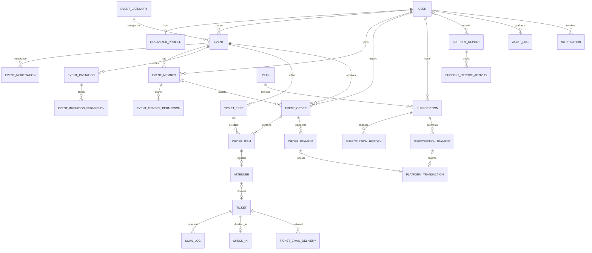

# Fondasi database E-Ticket

## Status

- `backend/prisma/schema.prisma` adalah rancangan Prisma 6.19 untuk PostgreSQL
  Supabase (32 model/tabel target), dengan seluruh objek aplikasi berada di
  schema `public`.
- Backend tidak memakai Prisma Client maupun Supabase JS untuk query runtime;
  API Express memakai koneksi PostgreSQL langsung (`pg`) melalui
  `src/config/db.js`. Modul `src/config/supabase.js` hanya alias kompatibilitas
  tanpa client Supabase. Flutter default ke API mode; integrasi seluruh domain
  belum selesai.
- Prisma Client/koneksi PostgreSQL hanya untuk backend tepercaya. Jangan pernah
  menaruh URL database atau Prisma Client di Flutter; koneksi database
  privileged dapat melewati RLS, sehingga otorisasi tetap wajib pada backend.
- Prisma initial migration dan 5 migration lanjutan **sudah diterapkan** dan
  tercatat di `_prisma_migrations` (6 migration, terakhir
  `20261118000100_fix_payment_status_enum`). `prisma migrate status` menyatakan
  schema up to date. Verifikasi read-only 18 November 2026:
  - 32 tabel aplikasi + `_prisma_migrations`, 19 enum, 54 foreign key,
    105 index aplikasi.
  - `prisma migrate diff --from-schema-datasource prisma/schema.prisma
    --to-schema-datamodel prisma/schema.prisma --script` menghasilkan
    `-- This is an empty migration.` (tidak ada drift struktur).
  - Function `moderate_event`, `create_event_order`, `simulate_event_payment`,
    dan `expire_event_order_reservations` tersedia di schema `public`.
  - Migration SQL lama di `supabase/migrations/` tetap bukan pengganti baseline
    Prisma dan tidak dijalankan pada database target.
- Kredensial DB dan `JWT_SECRET` telah dikonfirmasi dirotasi. Jangan menyalin
  nilainya ke log, issue, atau dokumentasi. RLS/grants belum aman: **0/32 tabel
  mengaktifkan RLS, 0 policy**, tetapi role `anon` dan `authenticated` memiliki 7
  privilege penuh pada setiap tabel (termasuk DELETE/TRUNCATE). Verifikasi
  18 November 2026: `anon`=231 grant, `authenticated`=231 grant.
  Pemilik tabel adalah `postgres` (juga role koneksi backend), sehingga
  mengaktifkan RLS tidak memutus backend. Wajib ditutup sebelum rilis.
- Flutter API mode sekarang menjadi default. Jalur Organizer Event dan moderasi
  event Admin memakai API untuk operasi event, kategori tiket, ringkasan,
  grafik, dan keputusan moderasi. Order/pembayaran serta pengambilan tiket
  berdasarkan order juga memakai API. Fallback mock hanya dipakai jika demo
  diminta eksplisit. Check-in, undangan staff, notifikasi, dan laporan dukungan
  tersedia di backend; integrasi Flutter untuk sebagian layar Organizer/Admin,
  paket/langganan, dan pengaturan/revenue masih belum selesai.
- Migration `20261113000400_event_orders_payments` menambah idempotency key dan
  hash akses guest, lalu RPC atomik untuk validasi publikasi event, harga,
  periode/kuota tiket, hold kuota, pembuatan order/peserta individual per
  tiket/pembayaran, pelepasan hold yang kedaluwarsa, dan penerbitan tiket saat
  pembayaran simulasi sukses.
  Backend menghitung biaya layanan Rp5.000 per order berbayar dan komisi 5%
  dari subtotal sebagai snapshot; frontend tidak mengirim harga. Token akses
  order guest dikirim satu kali, disimpan di secure storage Flutter, dan
  dikirim kembali melalui header `X-Order-Access-Token` (bukan URL/log request).
- Pembayaran VA di sini tetap simulasi, bukan gateway/bank. Endpoint simulasi
  dinonaktifkan kecuali `SIMULATED_PAYMENTS_ENABLED=true` dikonfigurasi untuk
  lingkungan pengujian/non-produksi. Tidak ada pembayaran sungguhan yang
  diproses.

## Ringkasan analisis implementasi

Flutter memakai model `User`, `Event`, `TicketType`, `Order`, `OrderItem`,
`Payment`, `Ticket`, `CheckIn`, laporan dukungan, paket, langganan, transaksi,
audit/settings, dan aktivitas. Banyak fitur masih berupa mock in-memory.
Service API di Flutter kini memakai endpoint order, payment, check-in, tiket,
undangan staff, notifikasi, dan laporan dukungan yang tersedia di Express.
Sebagian modul Admin/Organizer (paket, langganan, revenue, pengaturan, sebagian
operasi) masih memakai mock in-memory dan endpoint backend terkait belum ada.
Karena itu keberadaan model atau layar tidak diperlakukan sebagai bukti seluruh
alur produksi sudah selesai.

Backend aktual adalah Express 4/CommonJS dengan koneksi PostgreSQL langsung
(`pg`). Query mencakup `profiles`, `events`, `event_categories`, `ticket_types`,
`event_orders`, `order_items`, `attendees`, `order_payments`, `tickets`,
`check_ins`, `scan_logs`, `event_invitations`, `event_member_permissions`,
`support_reports`, `notifications`, `event_moderations`, `audit_logs`, dan
`revoked_tokens`. `profiles.id` adalah UUID bisnis yang diisi aplikasi; backend
mengelola `password_hash` dan JWT sendiri. Schema dan migration Prisma berada di
`backend/prisma/`; SQL migration Supabase lama dipertahankan sebagai historis.

### Konflik penting dengan PRD

1. PRD menetapkan role global `PARTICIPANT`, `ORGANIZER`, `ADMIN`; kode lama
   memuat `attendee`/`organizer`/`admin` dan menganggap staff sebagai membership
   event. Kolom `profiles.role` dipertahankan sebagai teks untuk kompatibilitas
   dan tidak dikonversi ke enum tanpa rekonsiliasi data.
2. `event_members` yang ada hanya menyimpan staff, role berhuruf kecil, tanpa
   permission atau invitation. Owner saat ini ditautkan lewat `events.created_by`.
   Schema mempertahankan bentuk ini dan menaruh izin/invitation di tabel terpisah.
3. API lama membuat tiket langsung untuk event tanpa Order/Attendee/Payment.
   Schema menambahkan alur PRD dengan relasi nullable pada tiket legacy agar
   integrasi dapat dilakukan bertahap.
4. Status event dan ticket model Flutter memakai huruf kecil, PRD memakai enum
   uppercase; status ticket API lama memakai `active`/`used`. Pemetaan/konversi
   kontrak belum dikerjakan. Kolom status ticket legacy karena itu tetap `String`;
   migrasi perlu memetakan nilai dan menambahkan constraint setelah data diperiksa.
5. Tarif komisi pada mock UI mempunyai representasi `5.0` persen dan `0.05`
   fraksi. Database menetapkan fraksi (`0.050000` = 5%) agar snapshot konsisten
   dengan kalkulasi transaksi; konversi kontrak aplikasi/backend masih perlu
   ditetapkan pada tahap integrasi. Nilai tarif bisnis tidak ditetapkan.

## Entitas dan relasi

| Tabel | Fungsi dan relasi utama |
|---|---|
| `profiles` | Profil aplikasi per UUID Supabase Auth; role/username/hash legacy disimpan apa adanya. ID tidak dibuat Prisma. |
| `organizer_profiles` | Ekstensi profil Organizer (1:1 ke `profiles`). |
| `event_categories`, `events` | Kategori (1:N event); event menunjuk pembuat, kategori dan menampung status moderasi/tampilan. Field jadwal awal dipetakan ke kolom lama `event_date`. |
| `event_moderations` | Riwayat keputusan Admin (N:1 event dan Admin). |
| `event_members`, `event_member_permissions`, `event_invitations`, `event_invitation_permissions` | Staff per event, izin granular (N:M melalui tabel junction), izin yang menunggu penerimaan undangan, dan token undangan; owner tetap direpresentasikan `events.created_by`. |
| `ticket_types` | Kategori/kuota/harga event; disimpan terpisah dari event dan di-snapshot ke order item. |
| `event_orders`, `order_items`, `attendees` | Order boleh guest (`purchaser_id` null); tiap order punya item tiket, tiap item dapat memiliki banyak attendee. `assisted_by_member_id` merekam anggota yang membantu. |
| `order_payments` | Pembayaran order terpisah dari status order; MVP hanya menamai metode sebagai simulasi VA. |
| `tickets`, `scan_logs`, `check_ins`, `ticket_email_deliveries` | Tiket terkait event dan opsional attendee untuk transisi dari API lama; scan log menyimpan percobaan, check-in sukses unik per tiket, dan delivery menyimpan retry email. |
| `plans`, `plan_features`, `subscriptions`, `subscription_history`, `subscription_payments` | Paket, fitur/batas, langganan dan histori/pembayaran. Tidak menetapkan tarif atau durasi final. |
| `platform_transactions` | Satu sumber payment order atau payment subscription; nilai gross, fee, komisi, revenue dan net merupakan snapshot. Constraint tepat-satu-sumber memerlukan `CHECK` SQL pada migration setelah rekonsiliasi. |
| `support_reports`, `support_report_activities` | Laporan dengan pelapor guest atau akun, referensi order opsional (termasuk input teks guest), token status disimpan sebagai hash, dan aktivitas publik/internal yang dibedakan oleh visibility. |
| `platform_settings`, `platform_setting_history`, `audit_logs` | Pengaturan JSON, histori perubahan dan jejak administratif. Pembatasan append-only/RLS tetap perlu disiapkan terpisah. |
| `event_activity_logs`, `notifications` | Aktivitas per event dan notifikasi per pengguna; ini fondasi untuk layar/service Flutter, bukan bukti fitur backend sudah terintegrasi. |
| `revoked_tokens` | Daftar token JWT yang dicabut sesuai migration dan logout API saat ini. |

## Keputusan constraint dan penghapusan

- Kunci bisnis menggunakan UUID; primary key `profiles.id` berasal dari Supabase
  Auth. Model `User` memetakan tabel bisnis `public.profiles`, bukan
  `auth.users`; Prisma tidak memodelkan atau mengubah tabel internal itu. FK
  aktual dari `profiles.id` ke `auth.users.id` harus diverifikasi read-only
  sebelum menetapkan migration.
- Uang memakai `Decimal(14,2)`, bukan floating point. `commission_rate` berupa
  rasio desimal. Waktu disimpan sebagai `timestamptz`.
- Unique: email profil, nama/slug kategori, anggota per event, permission per
  anggota, nomor order/invoice/laporan, kode tiket, hash token, attendee per
  tiket, pembayaran per referensi/idempotency key, satu check-in per tiket,
  feature key per plan, dan payment source per transaksi.
- Index memprioritaskan owner/event, status + waktu daftar, membership per user,
  scan/check-in, retry email, laporan, audit, serta notifikasi belum dibaca.
- Profil Auth tidak dihapus lewat Prisma. Event/order/tiket/riwayat transaksi dan
  audit menggunakan relasi restrict atau nullable/set-null agar histori tidak
  hilang; izin boleh cascade saat membership dihapus. Aturan final perlu cocok
  dengan FK live sebelum migration.
- Prisma tidak dapat mengekspresikan partial/expression unique index username
  `lower(username)` yang sudah dibuat SQL; index itu harus dipertahankan oleh
  SQL migration dan diperiksa saat introspeksi.
- `tickets.qr_code_data` dipertahankan untuk payload legacy API. Checkout order
  menerbitkan kode acak berentropi tinggi pada `ticket_code` dan QR berisi kode
  tersebut untuk kompatibilitas Flutter; nilai bearer masih tersimpan pada
  database. Kolom `token_hash` tersedia tetapi belum dipakai alur scanner.
  Endpoint `/tickets/validate`, `/tickets/verify`, `/check-ins`, dan
  `/check-ins/sync` sudah tersedia dengan otorisasi petugas serta transaksi
  atomik, tetapi verifikasi masih berbasis kode bearer, bukan hash. Karena itu
  ticketing/scanner belum siap produksi penuh.
- Constraint `sold + held <= quota`, satu owner aktif, satu current subscription,
  dan tepat satu sumber `platform_transactions` membutuhkan constraint,
  transaksi/partial index PostgreSQL atau enforcement backend; model Prisma
  sendiri tidak cukup untuk menyatakannya.

## Langkah aman sebelum migration

1. Rotasi password koneksi database Supabase dan `JWT_SECRET` sudah dikonfirmasi.
   Jangan menyalin nilainya ke log, issue, atau dokumentasi.
2. Introspeksi read-only telah mengonfirmasi tidak ada tabel aplikasi pada
   schema `public` di target yang dipilih. Sebelum deploy, cek migration history
   Supabase agar migration SQL lama tidak dijalankan bersamaan dengan baseline
   Prisma yang membuat tabel `event_members`.
3. Tinjau baseline lokal dan siapkan kebijakan RLS/grants untuk tabel baru.
   Jangan mengubah atau menghapus migration SQL lama tanpa strategi rekonsiliasi.
4. Penerapan database dilakukan manual setelah backup, tinjauan keamanan, dan
   persetujuan eksplisit. Setelah deploy, verifikasi migration history, kolom,
   FK, index, RLS/grants, dan `prisma migrate diff`/`prisma migrate status`.
   Jangan gunakan `db push` atau `migrate reset`.
